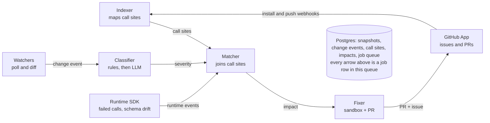
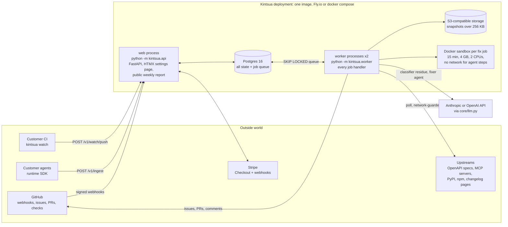
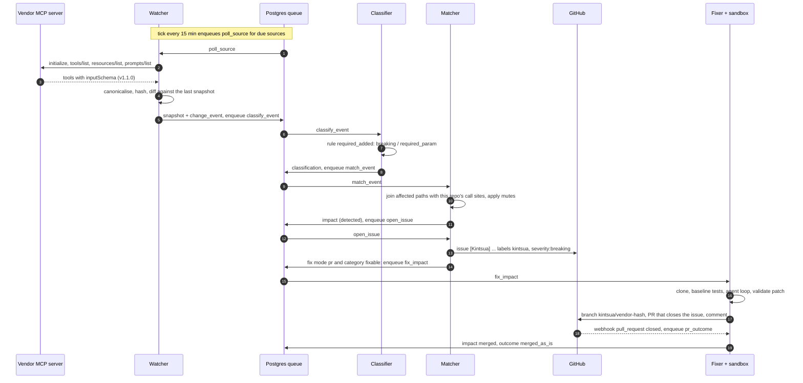
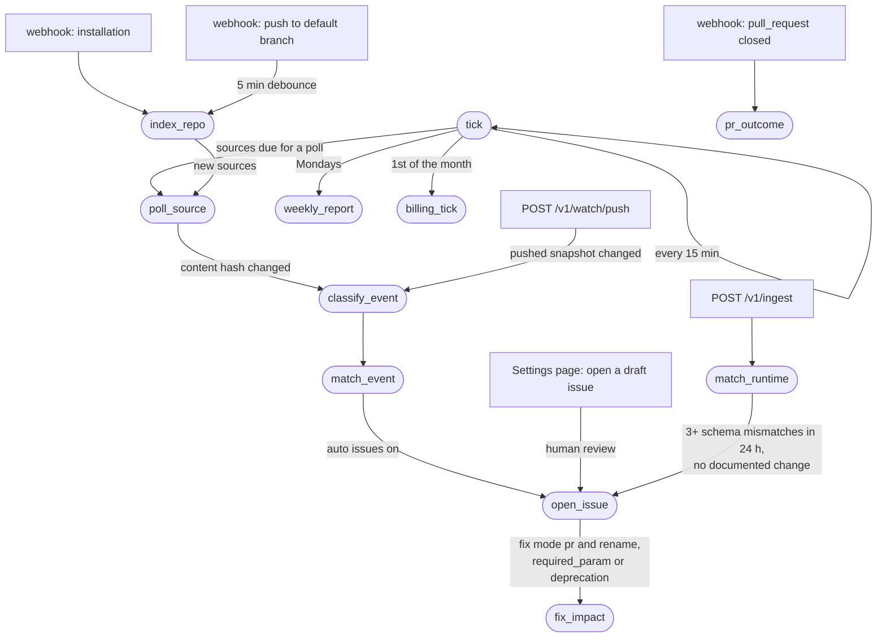
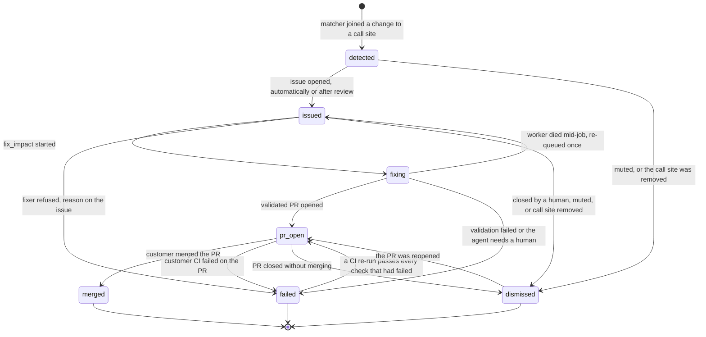
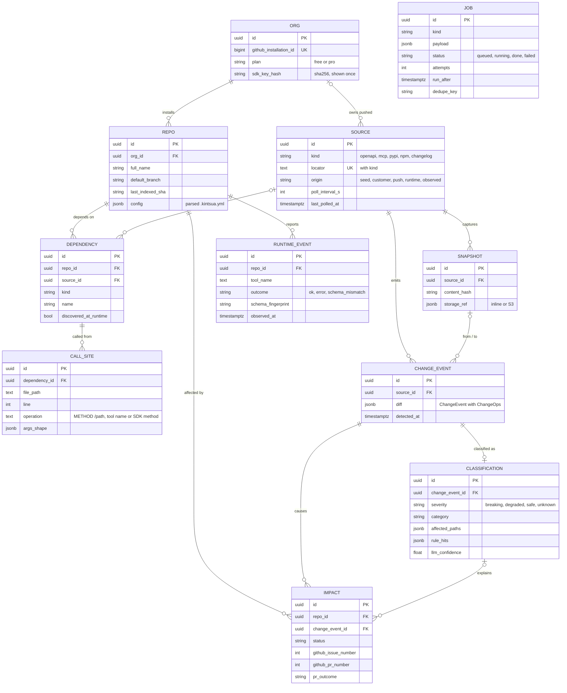

# Kintsua

**Self-maintaining integrations for AI agents.** Kintsua finds every external API and MCP tool an agent repo depends on, watches those upstreams for breaking changes, opens a GitHub issue within an hour of one landing, and opens a tested fix PR for the common cases.

It is a GitHub App plus a hosted watcher, with an open-source CLI (`kintsua watch`) and a runtime SDK (`import kintsua`) that reports failed tool calls and schema drift from production agents.

```
Watcher snapshot → diff → change_event → classifier severity → matcher joins call_sites
→ impact → GitHub issue → fixer PR, with runtime events entering at the matcher as a
second source of change events.
```

- **Install in under five minutes** from GitHub; the install issue is your dependency map.
- **Daily watch** of OpenAPI specs, MCP servers, PyPI/npm packages and changelog pages.
- **Rules first, model second**: every severity decision is reproducible; the model only sees what rules cannot decide, as data, never as instructions.
- **Fix PRs grounded in your call sites**, validated in a sandbox against your own tests before they are opened. A failing validation is an honest comment, not a PR.
- **Privacy defaults**: no payloads, no PII, SDK keys hashed at rest, a per-repo data deletion endpoint from day one.

Pricing: Free for public repos and up to 5 watched integrations · Pro $29 per watched integration per month.

---

## Contents

1. [Step-by-step guide](#1-step-by-step-guide)
2. [Quick start (the CLI, no account)](#2-quick-start-the-cli-no-account)
3. [The GitHub App](#3-the-github-app)
4. [Runtime SDK](#4-runtime-sdk)
5. [`.kintsua.yml`](#5-kintsuayml)
6. [Trust and data boundaries](#6-trust-and-data-boundaries)
7. [What the fixer refuses](#7-what-the-fixer-refuses)
8. [Known gaps](#8-known-gaps)
9. [Architecture](#9-architecture)
10. [Running it yourself](#10-running-it-yourself)
11. [HTTP API](#11-http-api)
12. [Testing](#12-testing)
13. [Layout](#13-layout)

---

## 1. Step-by-step guide

Pick the path that matches what you want to do. Each one is a numbered checklist you can follow top to bottom; the sections after this one are the reference.

| Path | You want to | Time | You need |
|---|---|---|---|
| [A. Watch from CI](#path-a-watch-an-mcp-server-or-api-from-ci) | fail a build when an MCP server or API you call changes | 10 minutes | Python 3.12 |
| [B. Run Kintsua](#path-b-run-kintsua-yourself) | operate the service: watcher, GitHub App, issues, fix PRs | about an hour | Postgres, a GitHub account, an Anthropic or OpenAI key, Docker for fix PRs |
| [C. Use it on your repo](#path-c-use-kintsua-on-your-repo) | get issues and fix PRs on your agent repo from a running Kintsua | 5 minutes | a running Kintsua (path B) |

> **Before you start.** The package is not on PyPI yet, so every install below comes straight from GitHub. There is no public hosted instance yet either: paths B and C use the instance you run yourself, and `KINTSUA_URL` points at it.

### Path A: watch an MCP server or API from CI

1. **Install the CLI** (base dependencies only, no server pieces):
   ```bash
   pip install "kintsua @ git+https://github.com/hr7657316/Kintusa-Ai"
   kintsua --version
   ```
2. **Take a snapshot** of the server or spec your agent calls. This writes `.kintsua/<name>.lock.json` with every tool, its input schema and a fingerprint.
   ```bash
   kintsua watch snapshot --server https://mcp.vendor.com/mcp --name vendor
   # stdio server:      --server "npx -y @vendor/mcp-server"
   # needs a token:     --auth-env VENDOR_TOKEN        (sent as Authorization: Bearer)
   # an OpenAPI spec:   --spec https://api.vendor.com/openapi.json
   ```
3. **Commit the lockfile.** From now on a schema change shows up as a diff in a pull request.
   ```bash
   git add .kintsua && git commit -m "kintsua: snapshot vendor MCP tools"
   ```
4. **Check for changes** locally whenever you like. Exit code `1` means a breaking change, `0` means none.
   ```bash
   kintsua watch diff --server https://mcp.vendor.com/mcp --name vendor
   ```
5. **Gate your CI.** Add a step that runs the same diff on every push. It prints annotations on the run and fails the job on a breaking change.
   ```yaml
   # .github/workflows/kintsua.yml
   name: kintsua
   on: [push, pull_request]
   jobs:
     watch:
       runs-on: ubuntu-latest
       steps:
         - uses: actions/checkout@v4
         - uses: hr7657316/Kintusa-Ai@main
           with:
             server: https://mcp.vendor.com/mcp
             fail-on: breaking            # or degraded
             snapshot-if-missing: "true"
             version: " @ git+https://github.com/hr7657316/Kintusa-Ai"   # until it is on PyPI
   ```
6. **When it fails,** read the table it prints (tool, change, severity, the rule that fired), update your code, then accept the new upstream state. The `--update` run still reports the change (exit `1`); the runs after it pass:
   ```bash
   kintsua watch diff --server https://mcp.vendor.com/mcp --name vendor --update
   ```
7. **See what drifted lately:** `kintsua watch report --since 7d` prints a Markdown summary from `.kintsua/history.jsonl`.

### Path B: run Kintsua yourself

**Prerequisites:** Python 3.12, [uv](https://docs.astral.sh/uv/), Postgres 16 (local or Docker), Node 20 (for stdio MCP servers), Docker (only for fix PRs), and a public HTTPS URL for GitHub webhooks (a deployment, or a tunnel such as `cloudflared tunnel --url http://localhost:8000` or ngrok while you try it).

1. **Get the code and dependencies.**
   ```bash
   git clone https://github.com/hr7657316/Kintusa-Ai && cd Kintusa-Ai
   uv sync --all-extras
   cp .env.example .env
   ```
2. **Fill in the basics in `.env`:** `DATABASE_URL`, `BASE_URL` (your public URL, the tunnel URL while testing), `ANTHROPIC_API_KEY` (or `LLM_PROVIDER=openai` and `OPENAI_API_KEY`), and a random `SESSION_SECRET` (`openssl rand -hex 32`). Leave the GitHub values empty for now.
3. **Create the database and load the 90 seeded sources** (Stripe, GitHub, Slack, Jira, Google discovery docs, public MCP servers, popular SDK packages):
   ```bash
   make db        # docker run postgres:16, or skip if you have a local server
   make migrate   # alembic upgrade head
   make seed      # python -m kintsua.seed
   ```
4. **Run the watcher once and read the drift report.** This is the week-one deliverable on its own: it works before any GitHub setup.
   ```bash
   make watch     # polls every seeded source, then prints the Markdown report
   ```
   Sources that need a token (several MCP servers) show `unconfigured: environment variable X is not set` until you set that variable.
5. **Start the service** in two terminals (or `scripts/dev.sh`, or `docker compose up --build`):
   ```bash
   make api       # http://localhost:8000: landing page, /report/weekly, /healthz
   make worker    # every background job; re-polls sources every 15 minutes
   ```
6. **Create your GitHub App in one click.** Open `BASE_URL/setup/github` and press the button. GitHub creates the App with the right permissions and events and sends you back to a page that shows `GITHUB_APP_ID`, `GITHUB_APP_PRIVATE_KEY`, `GITHUB_WEBHOOK_SECRET`, `GITHUB_OAUTH_CLIENT_ID` and `GITHUB_OAUTH_CLIENT_SECRET`. Copy them into `.env`, set `GITHUB_APP_SLUG` to the App's name, and restart the API and worker.
7. **Install the App on a repo** from the App's page on GitHub. Within a few minutes the worker clones it and opens the **install issue**: "Kintsua is watching N of your M external dependencies". If nothing appears, see the troubleshooting table below.
8. **Sign in** at `BASE_URL/login` (GitHub OAuth), then open `BASE_URL/settings`. For local experiments without OAuth: set `ENV=dev` and `DEV_LOGIN_INSTALLATION_ID=<id>` (the number at the end of the App installation's URL on GitHub) and visit `BASE_URL/auth/dev`.
9. **Decide how issues open.** Every org starts in review mode: matched changes become *draft* issues listed on the settings page under "Changes affecting this repo", and you press "Open all drafts" to post them. To post issues automatically, set `AUTO_ISSUE=true` for every org, or for one org:
   ```bash
   psql "$DATABASE_URL" -c "UPDATE org SET settings = settings || '{\"auto_issue\": true}' WHERE name = 'acme'"
   ```
   (Use a plain `postgresql://` URL with psql.)
10. **Turn on fix PRs** (optional). Build the sandbox image, use the Docker backend, and switch the repo to PR mode, either with "Fix mode" on the settings page or in the repo's `.kintsua.yml` (`fix: {mode: pr}`):
    ```bash
    make sandbox-image                  # docker build -t kintsua-sandbox:latest
    # .env: SANDBOX_BACKEND=docker      (the worker needs access to the Docker socket)
    ```
    The fixer only opens a PR for renames, new required parameters and SDK major bumps, and only when the repo's own tests pass after the patch. Otherwise it comments on the issue with the reason ([what the fixer refuses](#7-what-the-fixer-refuses)).
11. **Deploy for real.** `fly.toml` runs one web and two worker processes from one image and runs migrations on release. Set the secrets listed at the top of `fly.toml`. In production the service refuses to start with a weak `SESSION_SECRET` or without S3 storage for large snapshots. See [running it yourself](#10-running-it-yourself) for every setting.

### Path C: use Kintsua on your repo

1. **Install the App** on the repos that contain your agent (an operator from path B gives you the install link). Nothing else is required.
2. **Read the install issue.** It lists every external dependency Kintsua found: MCP servers from `.mcp.json` and similar configs, SDK packages, and raw HTTP hosts, each with its call-site count and whether it is watched.
3. **Watch what it missed.** For a grey (unwatched) row, add the vendor's spec, changelog or remote MCP URL, either under "Dependency map" on `BASE_URL/settings/<owner>/<repo>` or in a `.kintsua.yml` at the repo root:
   ```yaml
   sources:
     - kind: openapi
       url: https://api.vendor.com/openapi.json
       hosts: [api.vendor.com]
     - kind: mcp
       url: https://mcp.vendor.com/mcp
   ```
   Stdio MCP servers in your configs are never run by Kintsua; watch them through their npm/PyPI package or with path A's `--push` (step 8).
4. **When an issue arrives**, it tells you what changed upstream (before and after), when, which files and lines in your repo call it, and how to fix it. Fix it yourself, or let the fixer do it (step 5). Closing the issue marks the change as handled.
5. **Let Kintsua open fix PRs:** set Fix mode to `pr` on the settings page, or add `fix: {mode: pr, base: main}` to `.kintsua.yml`. Review the PR like any other: its body says what changed, which call sites it touched, and how it was verified (test command, baseline run, static checks). Kintsua never pushes to a protected branch and never force-pushes.
6. **Silence noise:** add a pattern under "Mute rules" or in `.kintsua.yml` (`mute: [stripe:/v1/legacy/*, tool:debug_*]`). Matching open issues are closed with a comment.
7. **Report live failures from production** (optional). Create an SDK key under "Runtime SDK key" (it is shown once), then:
   ```bash
   pip install "kintsua @ git+https://github.com/hr7657316/Kintusa-Ai"
   export KINTSUA_KEY=kts_... KINTSUA_REPO=acme/support-agent KINTSUA_URL=https://your-kintsua-host
   ```
   ```python
   import kintsua
   session = kintsua.wrap_mcp(session)              # an mcp ClientSession
   client = kintsua.wrap_http(httpx.AsyncClient())  # or a requests.Session
   kintsua.hook_langchain()                         # or hook_openai_agents() / hook_google_adk()
   ```
   Failed calls then show up on open issues ("12 failed calls in the last hour"), and a tool whose schema keeps changing without notice opens its own issue. No arguments or results are sent.
8. **Push snapshots from CI** (optional), for servers Kintsua cannot reach itself, such as stdio or internal ones: add `--push` to path A's diff step:
   ```bash
   kintsua watch diff --server "npx -y @vendor/mcp" --push --repo acme/support-agent
   # uses KINTSUA_KEY and KINTSUA_URL from the environment
   ```
9. **Remove your data** at any time with "Delete data" on the settings page. It deletes the repo's runtime events, dependencies, call sites and impacts; your GitHub issues and PRs stay.

### Troubleshooting

| Symptom | Check |
|---|---|
| No install issue after installing the App | The worker is running; the App's "Advanced" tab on GitHub shows webhook deliveries with status 200 (otherwise `BASE_URL` is not reachable or `GITHUB_WEBHOOK_SECRET` differs); then look at failed jobs: `psql "$DATABASE_URL" -c "select kind, status, last_error from job order by created_at desc limit 20"`. Re-run an index by hand with `uv run python -m kintsua.indexer.run owner/repo`. |
| A source shows as failing | Its `last_error` on the settings page or in the `source` table says why: an unset token (`unconfigured: ...`), a refused private address, a vanished spec. Failing sources retry with backoff up to 48 hours. |
| A change was detected but no issue opened | It is a draft: open it from the settings page, or turn on `AUTO_ISSUE`. Only `breaking` and `degraded` changes that touch one of your call sites become issues; the rest are in the weekly report. |
| No fix PR | The issue has a comment with the reason: not a fixable category, fix mode is `issue_only`, no test command, or validation failed. |
| SDK events never arrive | `KINTSUA_KEY`, `KINTSUA_REPO` and `KINTSUA_URL` are set in the agent's environment, and the repo is installed in the same org as the key. |
| `kintsua watch` exits `3` | It could not connect: wrong URL, the server is down, or it needs `--auth-env`. Exit `4` means there is no lockfile yet: run `snapshot` first. |
| The API or worker will not start in production | The log names the setting: a placeholder `SESSION_SECRET`, or no `S3_BUCKET` (set `DATA_DIR_SHARED=true` only when every process shares one disk). |

## 2. Quick start (the CLI, no account)

`kintsua watch` is the MCP/OpenAPI watcher and the rules classifier packaged as a CLI (Apache 2.0). It snapshots a server's `tools/list` into a lockfile you commit, so a schema change shows up in a PR diff, and it exits non-zero on breaking changes so it can gate a deploy.

```bash
pip install "kintsua @ git+https://github.com/hr7657316/Kintusa-Ai"   # until it is published to PyPI

# snapshot: writes .kintsua/<server>.lock.json (tools, inputSchemas, fingerprints)
kintsua watch snapshot --server https://mcp.vendor.com/mcp
kintsua watch snapshot --server "npx -y @vendor/mcp-server"        # stdio servers work too
kintsua watch snapshot --spec https://api.vendor.com/openapi.json  # OpenAPI 3.x / Swagger 2 / Google discovery

# diff: exit 1 on breaking changes, 0 otherwise; appends to .kintsua/history.jsonl
kintsua watch diff --server https://mcp.vendor.com/mcp
kintsua watch diff --server ... --fail-on degraded --github-action   # CI annotations + step summary
kintsua watch diff --server ... --json                               # the ChangeEvent + classification

# report: Markdown drift report from history.jsonl
kintsua watch report --since 7d
```

Useful flags: `--header K=V` (values may use `${VAR}`), `--auth-env NAME` (bearer token from an env var), `--env K=V` (for stdio servers), `--name` (lockfile base name), `--update` (rewrite the lockfile after diffing), `--dir` (default `.kintsua`).

The hosted product is one flag away: `kintsua watch diff --push --repo owner/name --key $KINTSUA_KEY` sends the snapshot to your account so the repo gets issues and PRs without CI running.

As a GitHub Action:

```yaml
- uses: hr7657316/Kintusa-Ai@main
  with:
    server: https://mcp.vendor.com/mcp
    fail-on: breaking
```

Exit codes: `0` no gate hit, `1` severity at or above `--fail-on`, `2` usage error or an unreadable lockfile (merge-conflict markers, or a lockfile another server wrote under the same `--name`), `3` could not connect (auth required, bad URL, server down), `4` no lockfile yet (run `snapshot`; the GitHub Action does this itself with `snapshot-if-missing: true`). `--auth-env` applies to `--spec` too, sent as `Authorization: Bearer`.

## 3. The GitHub App

GitHub is the whole v0 user interface: install is the signup, the install issue is the dependency map, issues are alerts, PRs are fixes.

1. **Install** the App on the repos you want watched (`https://github.com/apps/kintsua/installations/new`). Permissions: Contents (read/write), Pull requests (read/write), Issues (read/write), Metadata (read), Checks (read). No org-member or email scopes.
2. **Within an hour** the indexer clones the default branch, finds your MCP configs, SDK imports and raw HTTP calls, resolves each to a watched source, and opens the install issue: *"Kintsua is watching 11 of your 14 external dependencies"* with a table of dependency, kind, watch status and call-site count, and how to add a spec or changelog URL for the unwatched ones.
3. **When something breaks upstream**, the matcher joins the classified change against your call sites and opens one issue per change event and repo (never duplicates), labelled `kintsua` and `severity:breaking` or `severity:degraded`. The body says what changed (before/after), when, which files and lines in your repo call it, the migration hint, and whether a PR is coming.
4. **If fix mode is `pr`** and the change is a rename, a new required parameter or an SDK major bump, the fixer clones your repo into a sandbox, runs a bounded tool-using agent (12 steps, five tools), validates the patch against your own test command and static checks, and opens `kintsua/<vendor>-<hash>` with a PR body that states exactly how it was verified. The customer's CI result is captured back onto the impact.
5. **Every org starts in `issue_only` with draft issues** so a noisy first week cannot destroy trust: drafts are visible on `/settings/{owner}/{repo}` and in the weekly report, and a human flips them to real issues (or sets `AUTO_ISSUE=true` / the org setting once the golden set passes).

Push to the default branch re-indexes with a 5-minute debounce; an impact whose call site disappeared is closed with a comment saying why.

The weekly drift report (`/report/weekly`, also RSS and Markdown) lists every change event by severity, the ones that need a human look, sources that have been failing for 7+ days, and the fixer's merged-as-is rate.

## 4. Runtime SDK

The SDK sees what tools an agent actually calls and whether they still answer the way they did yesterday. Python only in v0, under 500 lines, one wrapper call, no payloads.

```python
import kintsua

# MCP: wrap any ClientSession from the official mcp package (1.x or 2.x)
session = kintsua.wrap_mcp(session, repo="acme/support-agent", key=KINTSUA_KEY)

# HTTP: wrap an httpx Client/AsyncClient or a requests Session
client = kintsua.wrap_http(httpx.AsyncClient(), repo="acme/support-agent", key=KINTSUA_KEY)

# Frameworks: one-line hooks (no-ops when the framework is not installed)
kintsua.hook_langchain(); kintsua.hook_openai_agents(); kintsua.hook_google_adk()
```

What it records: per MCP tool a `schema_fingerprint` (SHA-256 of the canonical `inputSchema`) compared with the last one stored locally, so a changed schema becomes a `schema_mismatch` event with the diff; per `tools/call` the tool name, latency, outcome and error class; per HTTP call host, method, normalised path, status, latency and, on 4xx/5xx, the first 512 bytes of the error body with secrets redacted. Arguments and results are never sent unless you pass `sample=True`, and then keys only.

Transport: batched every 5 seconds or 100 events to `POST /v1/ingest`, one retry then drop, never blocks or raises (every public function is wrapped; failures log once at debug level). Configure with `kintsua.configure(key=..., repo=..., url=...)` or `KINTSUA_KEY` / `KINTSUA_REPO` / `KINTSUA_URL`.

Server side, `match_runtime` creates `dependency` and `call_site` rows for tools and hosts the indexer never saw (`discovered_at_runtime`), promotes three or more `schema_mismatch` events for a tool within 24 hours with no documented change into a synthetic breaking change event (the vendor changed something they never documented), and attaches error spikes to open issues ("12 failed calls in the last hour").

## 5. `.kintsua.yml`

Optional, at the repo root. Add sources the indexer missed, mute noisy ones, choose whether PRs open automatically, set the base branch and the test command.

```yaml
sources:
  - kind: openapi
    url: https://api.vendor.com/openapi.json
    hosts: [api.vendor.com]            # raw HTTP calls to these hosts resolve to this spec
  - kind: changelog
    url: https://vendor.com/changelog
  - kind: mcp
    url: https://mcp.vendor.com/mcp    # or: command: "npx -y @vendor/mcp"
mute:
  - stripe:/v1/legacy/*
  - tool:debug_*
fix:
  mode: pr          # pr | issue_only (default issue_only)
  base: main
  radius: 1         # import hops the validator lets a patch reach beyond the call-site files
test_command: "uv run pytest -q"   # overrides detection (pyproject / package.json / Makefile)
```

## 6. Trust and data boundaries

Every watched source records where it came from (`source.origin`), and that decides what the hosted worker does with it:

- **Operator-seeded sources** (`kintsua/seed/sources.yml` and the curated SDK map) are the only ones the worker will run as stdio MCP commands, and the only ones on the public weekly report.
- **Sources from your repo or the settings page** (`.kintsua.yml`, MCP configs, raw HTTP hosts) are fetched over http(s) only. Kintsua never executes a command line it found in your repo; a stdio MCP server in your config is watched through its package on PyPI/npm, or through `kintsua watch --push` from your CI.
- **Every customer-supplied URL is network-guarded:** localhost, private, link-local and cloud-metadata addresses are refused, each redirect hop is re-checked, response bodies are size-capped and every poll has a time limit.
- **Pushed snapshots are scoped to your org.** A push can only change what your own repos see; it never touches a source another customer depends on.
- **The public weekly report** lists only operator-seeded sources, never a customer's repo, source, issue or PR, and redacts secrets from error text.
- **Runtime data stays thin:** the SDK sends tool names, latencies, outcomes and schema fingerprints, never arguments or results (keys only with `sample=True`); secrets in error bodies, URLs and paths are redacted on both the client and the server.

## 7. What the fixer refuses

The validator is the product: Kintsua never ships a PR whose tests did not run. The fixer leaves an issue (with a comment saying why) and opens no PR when:

- the change is not a `rename`, `required_param` or `deprecation` (SDK major bump), or is not `breaking`/`degraded`;
- the change touches authentication or secrets handling (category `auth`), or the patch would touch files matching `*.env`, `.env*`, `*secret*`, `*credential*`, `auth*.py|ts|js`, `*token*`, `*.pem`, `*.key`, `id_rsa*` or a `secrets/` / `credentials/` directory, or adds lines containing `api_key=`, `token=`, `secret=`, `password=`, `client_secret=`, `private_key=`, `Authorization` or a live key shape;
- the change would need new credentials or scopes;
- the repo has no test command and no static checks (adding either unlocks PRs);
- the test suite did not actually run, on the baseline or after the patch (pytest collection or usage errors, no tests collected): matching the baseline's failures only counts when tests really ran;
- the agent's patch exceeds 300 changed lines, touches files outside the affected call sites plus one import hop, fails the test command (or fails tests the baseline run on the unpatched tree passed), fails `ruff` / `tsc --noEmit` where present, or (for MCP tools) produces a call that does not validate against the new `inputSchema`;
- the agent stops with `done(needs_human=true)` because the fix needs a decision a human should make (for example a new required parameter with no inferable value);
- more than 3 fix jobs are already running: the job is deferred, not refused, and fails with a reason only after about 6 hours of deferrals. A fix job lost with its worker (a deploy or an out-of-memory kill) is re-queued once, then failed.

Kintsua never pushes to a protected branch and never force-pushes. Everything it writes is prefixed `[Kintsua]`, labelled `kintsua`, and lives on `kintsua/*` branches so it can be found and reverted.

## 8. Known gaps

- **Static indexing is partial by design.** Dynamic tool names built at runtime, URLs assembled from config or other modules, and monorepos with several services are indexed partially (constants are tracked per file; the first literal assignment wins). The runtime SDK closes these gaps by observing real calls.
- **SDK symbol to HTTP operation equivalence** is table-driven and covers Stripe, Slack, GitHub (PyGithub/Octokit), OpenAI, Anthropic, Notion, HubSpot, Twilio and SendGrid; other SDK call sites match package-level events (major bumps) but not individual OpenAPI operations.
- **OpenAPI `$ref` dereferencing is bounded** (one level inside `paths` by default; `components/schemas` are diffed per component) so Stripe/GitHub-sized specs stay fast; deep shared-schema changes report under `/components/schemas/...` and may not join to an HTTP call site. Raise `meta.deref_depth` per source if needed.
- **Renames** are detected between siblings under the same parent (identical shape or Levenshtein < 3); an operation moved between paths is reported as removal plus addition.
- **Changelog pages** must be server-rendered; JavaScript-rendered changelogs collapse to coarse text events.
- **Promotion from runtime** names a server-less MCP tool dependency after the tool unless the SDK knows the server locator.
- **Model agreement on the residue (90%)** is measured with real model calls outside the unit suite; the rules' 100% on the golden set is enforced in CI.
- **Sandbox egress** is a name-level allowlist unless `SANDBOX_HTTPS_PROXY` is set; agent, test and validation steps run with no network at all.
- No Slack or email alerts, no languages beyond Python and TypeScript, no self-hosting support, no rollback of agent actions (v1).

## 9. Architecture

One Python monorepo, one Postgres, one FastAPI service, one worker pool. Five components talk through the database and a job queue, never directly to each other, so each can be built and tested alone. The diagrams below are Mermaid; GitHub renders them inline.

### Components

Change events flow left to right from the watchers to a GitHub PR. The indexer and the runtime SDK feed the matcher from above and below, and GitHub webhooks trigger re-indexing.



| Component | Reads | Writes | Job kinds |
|---|---|---|---|
| **Watchers** (`kintsua/watchers`) | sources | snapshots, change events | `tick`, `poll_source` |
| **Classifier** (`kintsua/classify`) | change events, call-site operations | classifications | `classify_event` |
| **Indexer** (`kintsua/indexer`) | repo clone, `.kintsua.yml` | dependencies, call sites, install issue | `index_repo` |
| **Matcher** (`kintsua/matcher`) | classifications, call sites, runtime events | impacts, issues | `match_event`, `open_issue`, `match_runtime` |
| **Fixer** (`kintsua/fixer`) | impacts, snapshots | PRs, impact status/outcomes | `fix_impact`, `pr_outcome` |
| **API** (`kintsua/api`) | GitHub webhooks, SDK ingest, sessions | orgs, repos, runtime events, jobs | `billing_tick` |

### Deployment

One image runs as a web process and as worker processes. Postgres holds all state and is also the job queue.



### A breaking change, end to end

What happens when a vendor's MCP server makes a tool input required. This is the path `tests/e2e/test_mcp_to_issue.py` runs against a real local MCP server.



### Job graph

Every arrow between components is a row in the `job` table, claimed with `SELECT ... FOR UPDATE SKIP LOCKED`. Jobs that must not pile up carry a dedupe key, for example one queued `index_repo` per repo, which is how the push debounce works.



### Impact lifecycle

State lives on `impact` and `job`; every event row is immutable. Only the CI conclusions `failure` and `timed_out` move a PR to `failed`; `cancelled`, `action_required`, `neutral` and `skipped` are recorded without a status change.



### Data model

Twelve tables: the eleven from the spec plus `subscriber` for the weekly report, which is not drawn here. `docs/SPEC.md` is the product spec and `docs/CONTRACTS.md` holds the component contracts: job kinds, payloads, path dialects, cross-module seams and the source trust rules.



### Stack and scheduling

Stack: Python 3.12, FastAPI, SQLAlchemy 2 + Alembic, Postgres 16 (also the queue), httpx, the official `mcp` client (1.x and 2.x), tree-sitter (Python, TypeScript, TSX), PyGithub, Docker sandboxes, the Anthropic or OpenAI SDK behind one `core/llm.py` adapter (structured output for the classifier, a strict-schema tool loop for the fixer), Pydantic for every event schema.

Scheduling: a self-perpetuating `tick` job every 15 minutes enqueues `poll_source` for due sources (MCP 6h, OpenAPI 24h, packages 6h, changelog 24h; 1h for sources a paying customer depends on), with exponential backoff per failing source up to 48 hours. The weekly report runs on Mondays and the billing sync on the 1st.

## 10. Running it yourself

Requirements: Python 3.12, [uv](https://docs.astral.sh/uv/), Postgres 16 (local or Docker), Node 20 for stdio MCP servers and TypeScript checks, Docker for the fixer sandbox in production.

```bash
git clone https://github.com/hr7657316/Kintusa-Ai && cd Kintusa-Ai
cp .env.example .env                       # fill in what you have; everything is optional for a local run
uv sync --all-extras
make db                                    # docker run ... postgres:16  (or use a local server)
make migrate                               # alembic upgrade head
make seed                                  # 90 seeded sources: Stripe, GitHub, Slack, Twilio, Jira, Google discovery docs, MCP servers, SDK packages ...
make api                                   # python -m kintsua.api      -> http://localhost:8000
make worker                                # python -m kintsua.worker   -> tick + every job kind
make watch                                 # python -m kintsua.watchers.run --all --report   (the daily run + Markdown report)
```

`scripts/dev.sh` does all of that in one go. `docker compose up --build` runs Postgres, migrations, seeds, the API and two workers.

**Create the GitHub App in one click:** open `http://localhost:8000/setup/github` (or your deployed URL). It posts a GitHub App manifest with the right permissions and events; the callback shows the app id, private key, webhook secret and OAuth client id/secret as env lines to copy into `.env`. Restart, install the App on a repo, and watch the install issue appear.

**LLM:** `LLM_PROVIDER=anthropic` (default, `ANTHROPIC_API_KEY`) or `openai`; models default to `claude-opus-5-5` for both the classifier and the fixer (`LLM_CLASSIFIER_MODEL`, `LLM_FIXER_MODEL`, effort via `LLM_*_EFFORT`). `LLM_PROVIDER=fake` is what the tests use.

**Fixer sandbox:** `SANDBOX_BACKEND=docker` (production; build the image with `make sandbox-image`, mount the Docker socket into the worker) or `local` (development; no isolation). Limits: 15 minutes wall clock, 4 GB, 2 CPUs, 3 concurrent fix jobs.

**Snapshots over 256 KB** go to S3-compatible storage (`S3_*`) or, unset, to `DATA_DIR`.

**Deploy:** `fly.toml` runs one `web` process and `worker` processes from the same image with `alembic upgrade head` as the release command; `docker-compose.yml` is the equivalent for a VM.

**Production guards:** with `ENV=prod` the service refuses to start unless `SESSION_SECRET` is a random value of 32+ characters, and the API and workers refuse to start without S3 unless every process shares `DATA_DIR` (`DATA_DIR_SHARED=true`, as in the single-host compose file). Jobs whose worker died are handed out again after `JOB_LEASE_S` (15 minutes; running jobs heartbeat). On SIGTERM a worker lets the running job finish for `WORKER_SHUTDOWN_GRACE_S`, then returns it to the queue; keep that below the platform's kill timeout. After an outage that outlasted the retries, re-drive failed jobs with `python -m kintsua.worker --requeue-failed [--kinds classify_event,open_issue] [--since 24h]`.

Key environment variables (all in `.env.example`): `DATABASE_URL`, `BASE_URL`, `GITHUB_APP_ID`, `GITHUB_APP_PRIVATE_KEY`, `GITHUB_WEBHOOK_SECRET`, `GITHUB_OAUTH_CLIENT_ID/SECRET`, `SESSION_SECRET`, `DATA_DIR_SHARED`, `JOB_LEASE_S`, `WORKER_SHUTDOWN_GRACE_S`, `NET_GUARD`, `POLL_TIMEOUT_S`, `POLL_HTTP_TIMEOUT_S`, `SOURCE_BACKOFF_BASE_S`, `ANTHROPIC_API_KEY`, `AUTO_ISSUE`, `STRIPE_SECRET_KEY`, `STRIPE_WEBHOOK_SECRET`, `STRIPE_PRICE_ID`.

## 11. HTTP API

Eleven endpoints from the spec plus the few the CLI and the setup flow need. Everything else happens in GitHub.

| Method and path | Auth | Purpose |
|---|---|---|
| `POST /webhooks/github` | GitHub signature | installation, installation_repositories, repository (renames, default-branch changes), push, pull_request, issues, check_suite/check_run, workflow_run |
| `POST /v1/ingest` | SDK key | runtime event batches |
| `POST /v1/watch/push` | SDK key | a snapshot pushed by `kintsua watch --push` |
| `GET /v1/repos/{id}/dependencies` | session | dependency map JSON |
| `GET /v1/repos/{id}/changes` | session | change events affecting this repo, newest first |
| `POST /v1/repos/{id}/sources` | session | add a spec, changelog or MCP source |
| `POST`/`DELETE /v1/repos/{id}/mute` | session | mute / unmute a path or tool pattern |
| `POST /v1/repos/{id}/fix-mode` | session | switch `pr` / `issue_only` |
| `POST /v1/repos/{id}/issues/open` | session | turn a draft impact into a GitHub issue |
| `DELETE /v1/repos/{id}/data` | session | delete all runtime and index data for a repo |
| `POST /v1/keys`, `GET /v1/keys` | session | create or rotate the org's SDK key (shown once) |
| `GET /report/weekly` | public | the weekly drift report (`?format=md|rss|json`) |
| `POST /report/subscribe` | public | subscribe an email to the report |
| `POST /v1/billing/checkout`, `POST /v1/billing/webhook` | session / Stripe | Stripe Checkout and plan sync |
| `GET /login`, `GET /auth/callback`, `POST /logout` | | sign in with GitHub (scoped to the installations you can see) |
| `GET /settings/{owner}/{repo}` | session | the HTMX settings page |
| `GET /setup/github` | | GitHub App manifest flow |
| `GET /healthz`, `GET /` | public | health, landing page |

## 12. Testing

```bash
make test        # uv run pytest -q -m "not network"   (~750 tests, under 2 minutes, needs Postgres)
make smoke       # live end-to-end: real API + worker processes, a signed webhook, the CLI and the SDK (needs Postgres)
make lint        # ruff check + ruff format --check
```

What the suite covers: every watcher's `diff` against fixture pairs (MCP, OpenAPI 3, Swagger 2, Google discovery, PyPI/npm, changelog HTML) and a live stdio MCP server; a golden set of 50+ labelled change events with a CI check that the rules stay at 100%; the indexer against six fixture agent repos (LangChain, Google ADK, OpenAI Agents SDK, CrewAI, raw httpx, TypeScript) with exact dependency and call-site counts; matcher dialects, mutes, dedupe, runtime discovery and promotion; the fixer's sandbox, test-command detection, validator (including recorded breaks replayed against a fixture repo), agent loop, PR body and outcome capture; the SDK's wrappers, reporter and the 500-line boundary; the CLI against the fixture MCP server; the API's webhooks, ingest, settings, auth, report and billing; and `tests/e2e`, which runs the whole pipeline on the real job handlers: a local MCP server changes a tool schema and Kintsua produces the issue, the sandboxed PR, the merge outcome and the report numbers.

Tests marked `network` (real vendor specs, registries, public MCP servers) run on demand: `uv run pytest -m network`.

## 13. Layout

```
kintsua/
  api/          FastAPI: webhooks, ingest, repos, keys, report, billing, auth, settings pages, manifest setup
  core/         config, models, db, queue (SKIP LOCKED), storage, llm adapter, github app client, events
  watchers/     base, mcp, openapi, packages, changelog, schemadiff, run (tick + poll_source)
  classify/     rules, llm_classify, run, schema
  indexer/      clone, python_extract, ts_extract, mcp_config, sdk_map, resolve, depmap, config, run
  matcher/      match, issues, mute, operations, runtime
  fixer/        sandbox (docker | local), agent, validate, pr, testcmd, run
  sdk/          wrap, report, hooks        (import kintsua)
  cli/          kintsua watch
  report/       weekly report model, Markdown/RSS renderers, builder, job
  seed/         sources.yml + loader
alembic/        migrations
docker/         sandbox image
tests/          unit, integration, fixtures (changes golden set, agent repos, recorded breaks), e2e
docs/           SPEC.md, CONTRACTS.md
```

Licence: Apache 2.0.
